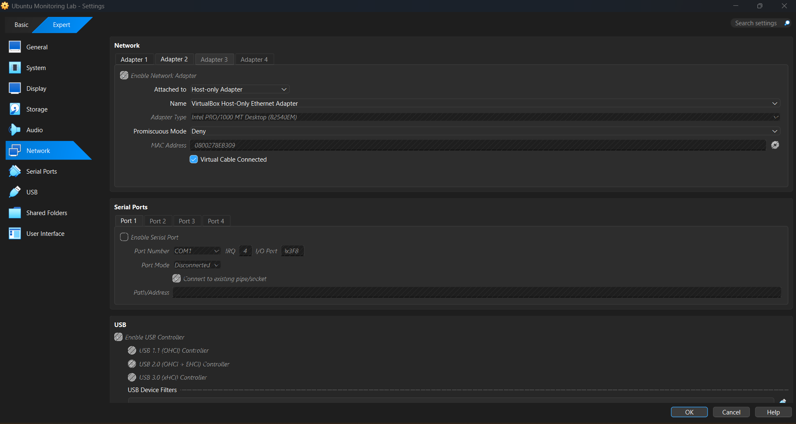
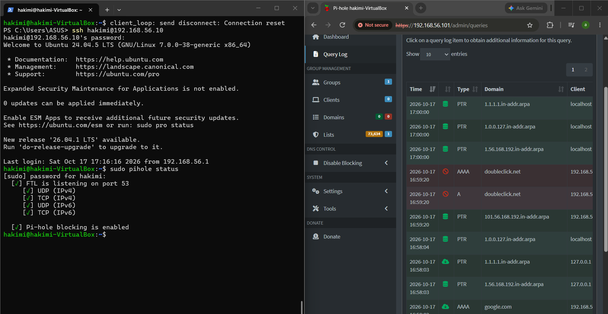
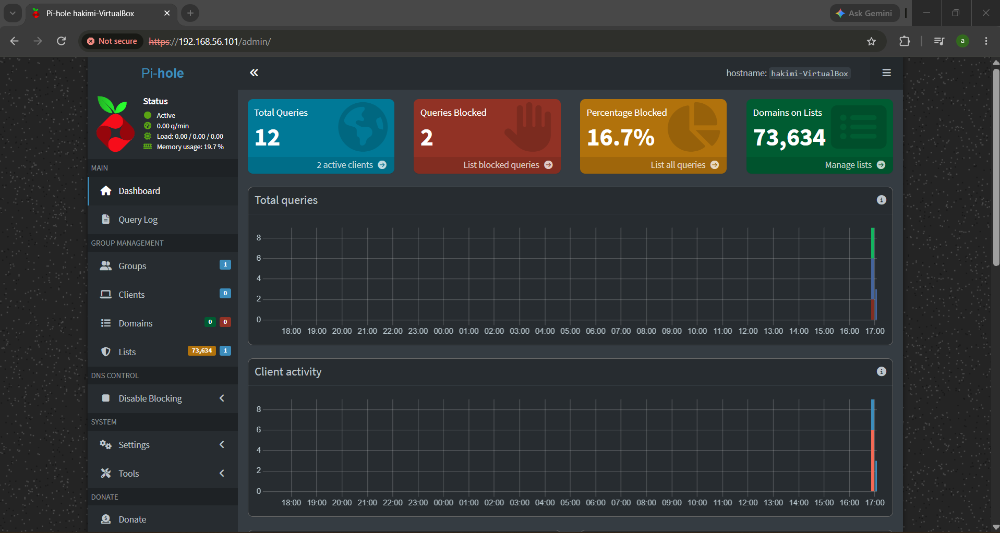

# Pi-hole DNS Ad-Blocking Homelab

## Overview

A personal homelab project built to practise Linux administration, DNS configuration, networking, and troubleshooting using Pi-hole on Ubuntu Server in Oracle VirtualBox.

<<<<<<< HEAD
## Overview
=======
## Lab Environment
>>>>>>> 961c776 (Add screenshots to README)

- **Operating System:** Ubuntu Server 24.04.5 LTS
- **Virtualisation:** Oracle VirtualBox
- **DNS Filtering:** Pi-hole v6
- **Upstream DNS:** Cloudflare (`1.1.1.1`)
- **Client:** Windows

## 1. Network Architecture

The Ubuntu virtual machine uses two network interfaces:

- **NAT (`enp0s3`):** Provides internet access to Ubuntu.
- **Host-only (`enp0s8`):** Allows Windows to communicate directly with Pi-hole.

A static IP address of `192.168.56.10` was configured on the host-only interface so the Windows host could consistently reach the DNS server.

<<<<<<< HEAD
## Lab Environment
=======

>>>>>>> 961c776 (Add screenshots to README)

## 2. DNS Filtering and Validation

Windows was configured to use Pi-hole at `192.168.56.10` as its DNS server.

<<<<<<< HEAD
 **Operating System:** Ubuntu Server 24.04.5 LTS

 **Virtualisation:** Oracle VirtualBox

 **DNS Filtering:** Pi-hole v6

 **Upstream DNS:** Cloudflare

 **Client:** Windows PowerShell
=======
DNS resolution was tested using `nslookup`:

- `google.com` resolved successfully through Pi-hole.
- `doubleclick.net` returned `0.0.0.0` and `::`, confirming that the tested domain was blocked.



## 3. Pi-hole Dashboard

The Pi-hole web interface was accessed to verify that the service was running and DNS blocking was enabled.
>>>>>>> 961c776 (Add screenshots to README)



## Implementation

<<<<<<< HEAD
## Network Design
=======
- Installed Pi-hole on Ubuntu Server.
- Configured Cloudflare as the upstream DNS provider.
- Enabled the StevenBlack blocklist and DNS query logging.
- Configured a persistent static IPv4 address using NetworkManager.
- Configured Windows to use Pi-hole for DNS resolution.
- Verified DNS resolution and domain blocking using `nslookup`.
- Checked service status and validated operation after a reboot.
>>>>>>> 961c776 (Add screenshots to README)

## Key Learning Outcomes

- Understanding DNS resolution and upstream DNS providers.
- Differentiating VirtualBox NAT and Host-only networking.
- Configuring a static IPv4 address using NetworkManager.
- Testing DNS behaviour with `nslookup`.
- Troubleshooting service and web-interface issues.
- Validating services after a system reboot.

<<<<<<< HEAD
| Interface | Network Mode | IP Address | Purpose |

|---|---|---|---|

| `enp0s3` | NAT | `10.0.2.15` | Internet access for Ubuntu |

| `enp0s8` | Host-only | `192.168.56.10` | Communication between Windows and Pi-hole |


The host-only network allows Windows to query Pi-hole directly without changing DNS settings on the household router.


## Implementation


\- Installed and configured Pi-hole on Ubuntu Server.

\- Configured Cloudflare as the upstream DNS provider.

\- Enabled the default StevenBlack blocklist and DNS query logging.

\- Configured a persistent static IP address for the host-only interface.

\- Configured Windows to use Pi-hole for DNS resolution.

\- Tested DNS resolution and domain blocking using `nslookup`.

\- Troubleshot a port 80 conflict between an existing Nginx service and Pi-hole's web interface.


## Validation


### DNS Resolution


Command:


```powershell

nslookup google.com

```


Result: Windows successfully resolved `google.com` through Pi-hole at `192.168.56.10`.


### Domain Blocking


Command:


```powershell

nslookup doubleclick.net

```


Result: Pi-hole returned `0.0.0.0` and `::`, confirming that the tested domain was blocked.


### Service Status


Verified that Pi-hole FTL was listening on DNS port 53 and that blocking was enabled.


### Reboot Test


Restarted Ubuntu Server and verified that Pi-hole's DNS service and blocking were operational afterwards.


## Key Learning Outcomes


\- Understanding DNS resolution and upstream DNS providers.

\- Differentiating VirtualBox NAT and Host-only networking.

\- Configuring a static IPv4 address using NetworkManager.

\- Verifying DNS behaviour using `nslookup`.

\- Checking service status and troubleshooting web port conflicts.

\- Validating service availability after a system reboot.


## Future Improvements


\- Set up secure remote access using Tailscale.

\- Explore monitoring and DNS query analysis.

\- Document further troubleshooting scenarios.


=======
## Future Improvements
>>>>>>> 961c776 (Add screenshots to README)

- Set up secure remote access using Tailscale.
- Explore DNS monitoring and query analysis.
- Document additional troubleshooting scenarios.
